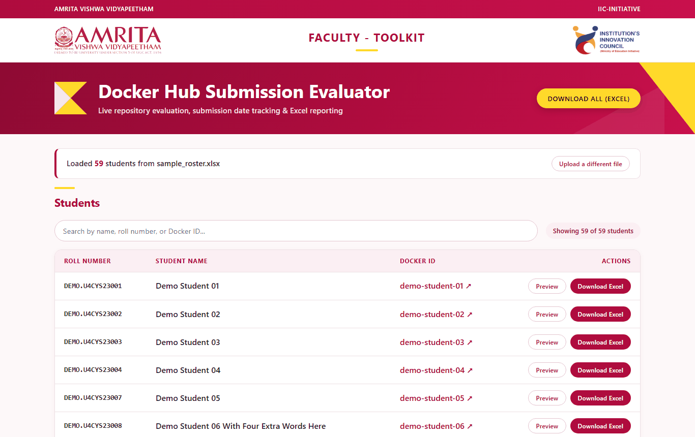
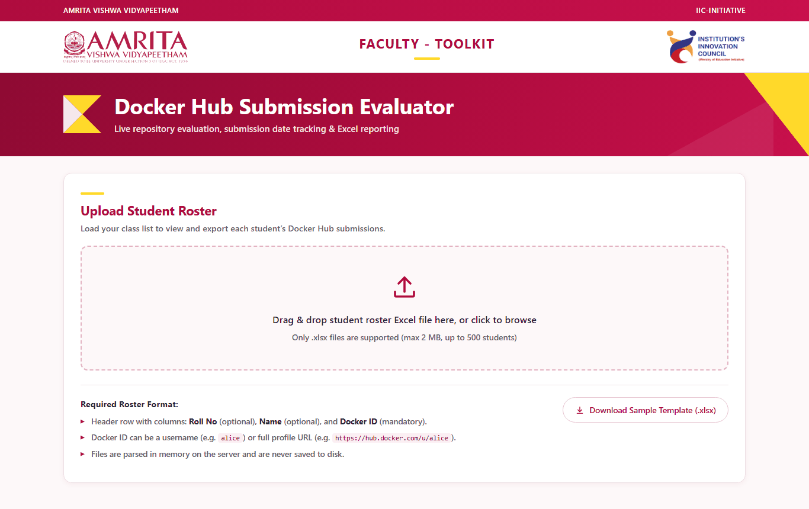
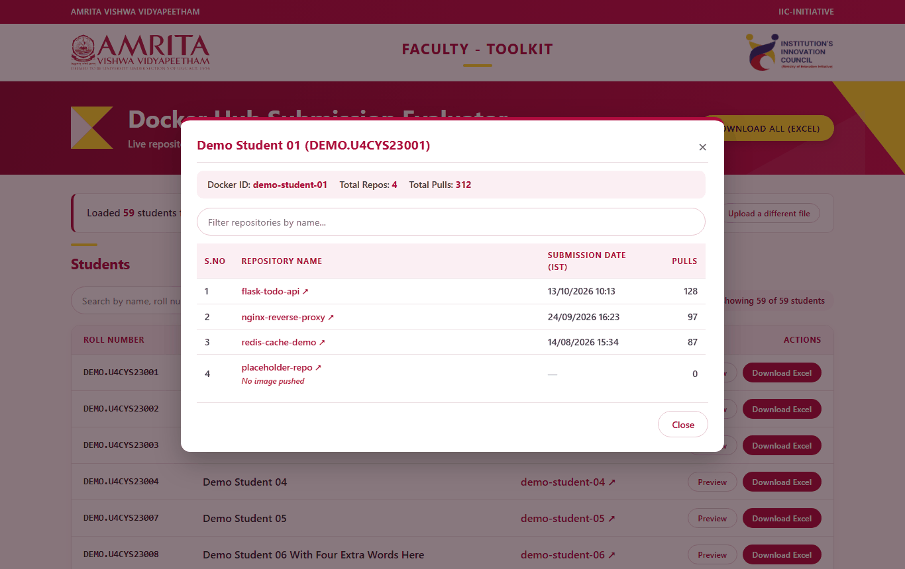
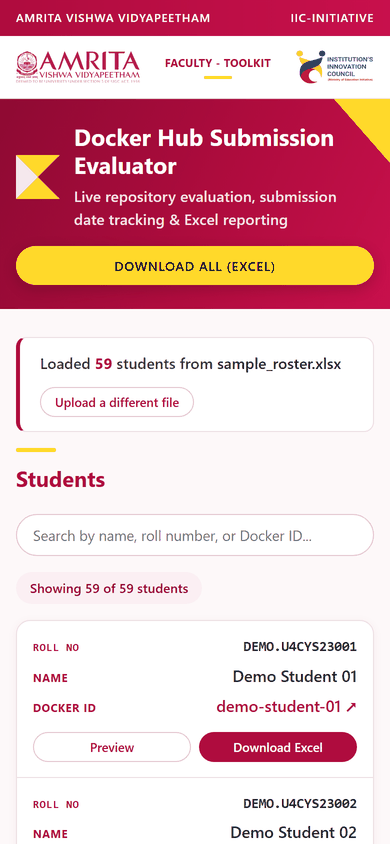
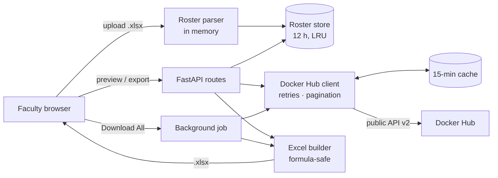

<p align="center">
  
  &nbsp;&nbsp;&nbsp;&nbsp;
  
</p>

<h1 align="center">Docker Hub Submission Evaluator</h1>

<p align="center">
  <strong>Faculty Toolkit · Amrita Vishwa Vidyapeetham · IIC Initiative</strong><br>
  Upload a class roster, see every student's Docker Hub repositories with real push dates, and export grading-ready Excel reports.
</p>

<p align="center">
  
  
  
  
</p>



---

## Why this exists

In DevOps and cloud courses, students submit their work as Docker Hub images. Checking those submissions by hand is slow and error-prone:

- Faculty open dozens of profiles one by one.
- Docker Hub's "last updated" date is not the same as when an image was actually pushed, so it is a poor basis for deadlines.
- Repositories that were created but never received an image look like submissions at a glance.
- Every batch, section and year has a different student list.

This tool turns that into a two-minute job: **upload the roster, review, download the report.**

## Features

| | |
|---|---|
| **Roster upload** | Drag in any `.xlsx` class list. Headers are detected automatically (`Docker ID`, `Roll No`, `Name` and common variants), profile URLs are normalised to usernames, and bad or duplicate rows are listed with the exact reason they were skipped. |
| **Live Docker Hub data** | Every public repository and tag is fetched live, following pagination, with polite concurrency limits and automatic retry on rate limits. |
| **Trustworthy submission dates** | The submission date is the latest tag push (configurable to first push or repo creation), shown in IST. Repos with no image are marked **"No image pushed"**. |
| **Honest about failures** | If Docker Hub rate-limits or errors mid-fetch, the repo is flagged "Tag data unavailable – re-check later" instead of being misreported as empty, and partial results are never cached. |
| **Quick preview** | See a student's repositories, dates and pull counts in a pop-up before downloading anything. |
| **Excel reports** | A per-student workbook (Repositories, Summary, Tags, Notes) or one combined workbook for the whole class, built in the background with a progress bar. Optional On time / Late column against a deadline. |
| **Safe by design** | Uploads and reports live only in memory and are never written to disk. Every Excel cell is protected against formula injection. Students can only be looked up through an uploaded roster. |
| **College theme** | Amrita crimson-and-yellow branding with the Amrita and IIC logos. Fully usable on phones: the student table becomes stacked cards. |

## Screenshots

| Upload | Student preview | Phone |
|---|---|---|
|  |  |  |

<sub>All screenshots use synthetic demo data (`Demo Student NN`, `demo-student-NN`).</sub>

---

## Quick start

**Requirements:** Python 3.11 or newer.

```bash
git clone https://github.com/adarsh27062005-prog/docker-automation-faculty-toolkit.git
cd docker-automation-faculty-toolkit

python -m venv .venv
# Windows PowerShell
.\.venv\Scripts\Activate.ps1
# macOS / Linux
source .venv/bin/activate

pip install -r requirements.txt
cp .env.example .env          # optional: adjust settings (Windows: copy .env.example .env)

uvicorn app.main:app --host 127.0.0.1 --port 8000 --reload
```

Open **http://127.0.0.1:8000**, click **Download Sample Template**, fill it in (or use the bundled `sample_roster.xlsx`), and upload it.

> Run a **single** server process (no `--workers N`): rosters, export jobs and the cache are kept in that process's memory. Restarting the server clears them, so faculty simply upload the roster again.

## Roster format

An `.xlsx` workbook. The sheet named `Students` is used if present, otherwise the first sheet.

| Column | Required | Accepted headers | Example values |
|---|---|---|---|
| Docker ID | **Yes** | `Docker ID`, `Docker Username`, `Docker URL`, `Docker Hub ID`, `docker` … | `alice`, `https://hub.docker.com/u/alice` |
| Roll number | No | `Roll No`, `Roll Number`, `Reg No`, `Register Number` … | `CS101` |
| Name | No | `Name`, `Student Name`, `Student` | `Alice Kumar` |

- The header row can be anywhere in the first 10 rows.
- Blank rows are ignored. Duplicates and invalid IDs are skipped and listed on screen.
- Limits: 2 MB per file, 500 students per roster (configurable).

## Configuration

Set these in `.env` (see [`.env.example`](.env.example)). All are optional.

| Variable | Default | What it does |
|---|---|---|
| `SUBMISSION_DATE_BASIS` | `last_push` | Which date counts as the submission: `last_push`, `first_push` or `created`. |
| `SUBMISSION_DEADLINE` | *(unset)* | ISO date-time, e.g. `2026-07-01T23:59:59+05:30`. Adds an **On time / Late** column. |
| `DISPLAY_TZ` | `Asia/Kolkata` | Time zone for dates in the UI and reports. |
| `CACHE_TTL_SECONDS` | `900` | How long complete Docker Hub results are cached. |
| `MAX_UPLOAD_MB` / `MAX_STUDENTS` | `2` / `500` | Upload limits. |
| `ROSTER_TTL_HOURS` / `MAX_ROSTERS` | `12` / `50` | How long uploaded rosters are kept, and how many at once. |
| `JOB_TTL_HOURS` | `2` | How long a finished class export stays downloadable. |
| `GITHUB_README_LOOKUP` | `false` | Also scan each repo's README for linked GitHub URLs (slower). |
| `OVERRIDES_FILE` | `overrides.csv` | Optional `docker_id,github_url` mapping for manual GitHub links. |
| `GITHUB_TOKEN` | *(unset)* | Reserved for GitHub metadata enrichment; not used yet. |
| `BASIC_AUTH_USERNAME` / `BASIC_AUTH_PASSWORD` | *(unset)* | Shared faculty login for a public deployment. Required only when **both** are set. Set them on the host, never in the repo. |

---

## How it works



1. **Upload:** the roster is parsed from memory with `openpyxl` and stored under a random ID.
2. **Fetch:** for each student, the app lists public repositories and their tags from Docker Hub's public API, at most 3 requests at a time, retrying on HTTP 429/5xx.
3. **Decide the date:** the submission date is computed per repo from the tag push times. Missing or failed data is labelled, never guessed.
4. **Report:** results are shown in the browser or written to Excel. The class export runs as a background job that the page polls every 2 seconds.

### API

| Method | Endpoint | Purpose |
|---|---|---|
| `GET` | `/` | Web interface |
| `GET` | `/api/health` | Health check |
| `GET` | `/api/template` | Download the roster template |
| `POST` | `/api/roster` | Upload a roster (`multipart/form-data`) |
| `GET` | `/api/roster/{roster_id}` | Roster summary and skipped rows |
| `GET` | `/api/roster/{roster_id}/students` | Students in the roster |
| `GET` | `/api/roster/{roster_id}/students/{docker_id}/preview` | Live repositories for one student |
| `GET` | `/api/roster/{roster_id}/students/{docker_id}/export` | Per-student Excel workbook |
| `POST` | `/api/roster/{roster_id}/export-all/start` | Start the class export job |
| `GET` | `/api/jobs/{job_id}` | Job progress |
| `GET` | `/api/jobs/{job_id}/download` | Download the finished class workbook (`409` while still running) |

## Security and privacy

- **Nothing is stored on disk.** Uploaded rosters and generated reports exist only in memory and expire automatically.
- **Formula-injection safe.** Any cell text starting with `=`, `+`, `-`, `@`, tab or carriage return is written as plain text.
- **No open proxy.** Docker Hub is only queried for IDs that exist in an uploaded roster. Roster and job IDs are random 128-bit tokens.
- **Optional shared login.** Set `BASIC_AUTH_USERNAME` and `BASIC_AUTH_PASSWORD` and every page, file and API call requires that login (only `/api/health` stays open for the host's health checks). There are no individual user accounts.

## Deploy your own copy (Render, free)

The repo includes a [`render.yaml`](render.yaml) Blueprint, so Render can build and host it straight from GitHub and redeploy on every push.

1. Sign in at [render.com](https://render.com) with your GitHub account.
2. **New → Blueprint**, pick this repository, and confirm.
3. When asked, enter a `BASIC_AUTH_USERNAME` and `BASIC_AUTH_PASSWORD` for faculty (or leave both empty for an open site).
4. Wait for the first build (about 2–3 minutes), then open the `onrender.com` link Render shows.

The free plan sleeps after 15 minutes without visitors, so the first visit after a pause takes about 30–60 seconds to wake up, and uploaded rosters are cleared when it sleeps.

**Campus deployment:** run `uvicorn app.main:app --host 0.0.0.0 --port 8000`, allow the port through the firewall, and share `http://<server-ip>:8000` with faculty. On Windows Server:

```powershell
New-NetFirewallRule -DisplayName "Docker Submission Evaluator" -Direction Inbound -LocalPort 8000 -Protocol TCP -Action Allow
```

## Tests

```bash
pytest
```

58 tests run fully offline in under 10 seconds. Docker Hub is mocked, covering roster parsing edge cases, pagination, rate-limit and failure handling, date logic, Excel structure, formula-injection protection, routes, background jobs and branding assets.

## Project structure

```
app/
├── main.py           FastAPI routes
├── roster.py         Roster parsing and in-memory store
├── dockerhub.py      Docker Hub client (pagination, retries, date logic)
├── excel.py          Workbook builders and formula-injection guard
├── jobs.py           Background class export
├── cache.py          In-memory TTL cache
├── github_links.py   GitHub URL discovery
├── config.py         Settings from environment
└── static/           Web interface and logos
tests/                Offline test suite
docs/screenshots/     README images (demo data)
scripts/, scratch/    Development and verification helpers
sample_roster.xlsx    59-student demo roster
sample_messy.xlsx     Demo roster with deliberate errors
```

## Data notice

This repository contains **only synthetic data**. Every student name, roll number and Docker ID in the samples, tests and docs (`Demo Student NN`, `DEMO.U4CYS23NNN`, `demo-student-NN`) is made up. Use the app with your own roster; it never saves uploaded data.

## Acknowledgements

Built for faculty at **Amrita Vishwa Vidyapeetham** under the **Institution's Innovation Council (IIC)**, a Ministry of Education initiative. The Amrita and IIC names and logos belong to their respective owners and are used here to identify the institution this tool was built for.
