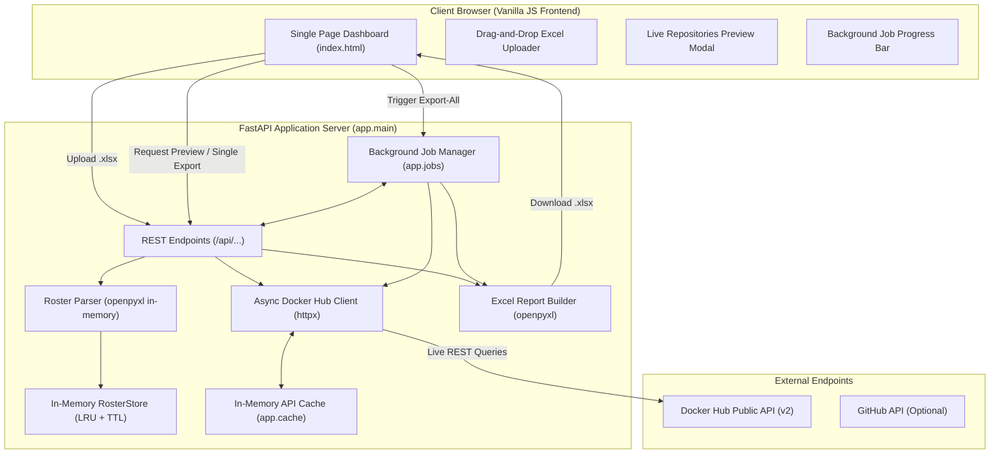

# Docker Hub Submission Evaluator — Project Context & Architecture

This document provides a comprehensive technical record of the **Docker Hub Submission Evaluator**, capturing the historical progression, system architecture, API specifications, security mitigations, and operational procedures implemented across all project phases and upgrades.

---

## 1. Executive Summary & Purpose

The **Docker Hub Submission Evaluator** is a specialized web application engineered for university and college faculty to inspect, verify, and grade students' Docker Hub submissions. 

### The Core Problem
In software and DevOps courses, students submit Docker Hub usernames or profile URLs corresponding to assigned containerization projects. Faculty face significant hurdles evaluating these submissions:
- Students frequently misplace or omit submission links.
- Public repositories lack a single aggregated view showing when images were actually pushed versus when the repository metadata was created.
- Manual verification of multiple repositories, tags, pull counts, and READMEs across dozens of students is time-consuming and error-prone.
- Hardcoded student lists prevent multiple faculty from using the tool across different batches, sections, or academic years.

### The Solution
A lightweight, fast, self-contained Python web application (FastAPI + Vanilla JS + openpyxl) featuring:
1. **Dynamic Roster Upload:** Faculty upload student lists as Excel spreadsheets (`.xlsx`). Parsed strictly in-memory; no files are saved to disk.
2. **Faculty-First Focus:** Live querying of Docker Hub's public API displaying **ALL** repository names submitted by each student, complete with clickable links and submission dates.
3. **Accurate Submission Timestamps:** The official submission date is defined as the most recent tag push (`max tag_last_pushed`) rendered in Indian Standard Time (IST / UTC+5:30), distinguishing between active submissions and empty/untagged placeholders.
4. **Rich Export Capabilities:** Interactive preview modal, dedicated single-student Excel workbooks (`.xlsx`), and asynchronous background combined roster exports.
5. **Defensive Architecture:** Complete protection against Excel formula injection (CSV/DDE attacks), memory-safe background jobs, polite rate limiting, and zero third-party database dependencies.

---

## 2. Project Evolution & Milestone History

The project evolved through targeted phases and major upgrades:

```
[Phase 0: API Verification] ──> [Phase 0.5: 59-Student Survey] ──> [Phases 1-6: Core App]
                                                                          │
[Upgrade 2: Dynamic Roster Upload & Background Jobs] <── [Upgrade 1: Faculty Revision]
```

### Phase 0: Public API Verification
- **Goal:** Verify Docker Hub's live public endpoints against specification before writing application code.
- **Findings:**
  - `GET https://hub.docker.com/v2/repositories/{namespace}/?page_size=100`: Returns pagination `count`, `next`, `previous`, and `results` containing `name`, `pull_count`, `last_updated`, and `description`.
  - `GET https://hub.docker.com/v2/repositories/{namespace}/{repo}/`: Repo details endpoint. `full_description` (README) is omitted if empty, rather than returned as null.
  - `GET https://hub.docker.com/v2/repositories/{namespace}/{repo}/tags/?page_size=100`: Returns tag details including `name` and `tag_last_pushed`.

### Phase 0.5: Full Submission Survey
- **Implementation:** Standalone polite script at `scripts/survey.py` querying all 59 original students from `docker_id.md`.
- **Survey Findings:**
  - Concurrency capped at 3 with exponential backoff on HTTP 429.
  - Surveyed 59 accounts, 759 public repositories, and thousands of image tags.
  - **Key Architectural Discovery:** Exactly **0 GitHub URLs** were found across all 759 public repositories. Students had not linked their GitHub repositories in Docker descriptions or READMEs.
  - **Strategic Outcome:** GitHub repository columns were made dynamic—omitted entirely if no GitHub links are discovered, preventing sparse or misleading tables.

### Phases 1–6: Baseline Application Architecture
- **Phase 1 (Parser):** Markdown table parser `app/parser.py` extracting student data from legacy `docker_id.md`.
- **Phase 2 (Docker Hub Client & Cache):** Async client `app/dockerhub.py` utilizing `httpx` with semaphore-limited concurrency (`asyncio.Semaphore(3)`) and an in-memory TTL cache (`app/cache.py`, 900-second TTL).
- **Phase 3 (GitHub Link Discovery):** Pattern matching engine in `app/github_links.py` checking `overrides.csv`, description text, and optional GitHub API enrichment.
- **Phase 4 (Excel Engine):** Multi-sheet workbook builder in `app/excel.py` using `openpyxl`, with native IST date formatting and frozen headers.
- **Phase 5 (FastAPI & Web UI):** Single-page web dashboard with search, tabular presentation, and direct download triggers.
- **Phase 6 (Hardening):** Pinned `requirements.txt`, `.env.example`, and offline test suite.

### Upgrade 1: Faculty Usability Revision
- **Faculty Requirement:** Shift focus from repository descriptions to raw repository links and verifiable push dates.
- **Runtime Decoupling:** Purged static survey dependencies from the running app; all queries fetch live from Docker Hub with pagination.
- **Submission Date Logic:** Standardized on `last_push` (most recent tag push across all tags) converted to IST (`Asia/Kolkata`). Repositories with no pushed images explicitly flagged with blank date and `"No image pushed"` note.
- **Workbook Restructuring:** The `"Repositories"` sheet was made Sheet 1 and active by default.
- **Interactive Preview Modal:** Added modal in the web interface for instant review before initiating file downloads.

### Upgrade 2: Dynamic Excel Roster Upload & Background Jobs
- **Decoupling from Hardcoded Data:** Eliminated all reliance on `docker_id.md`, removing hardcoded course codes, batch years, and fixed student counts from `app/` and `app/static/`.
- **In-Memory Roster Parsing (`app/roster.py`):**
  - Accepts `.xlsx` files via drag-and-drop or file picker.
  - Scans first 10 rows for flexible header aliases (`Docker ID`, `Roll No`, `Name`).
  - Normalizes full profile URLs (e.g., `https://hub.docker.com/u/alice` $\rightarrow$ `alice`).
  - Rejects malformed rows and tracks duplicate rows cleanly.
- **In-Memory Store (`RosterStore`):** Stores rosters under cryptographically secure identifiers (`secrets.token_urlsafe(16)`) with LRU eviction and 12-hour TTL.
- **Formula Injection Mitigation:** Built `set_safe_cell()` to sanitize any string cell beginning with `=`, `+`, `-`, `@`, `\t`, or `\r`.
- **Asynchronous Combined Export (`app/jobs.py`):** Background job runner for multi-student exports with real-time UI polling and progress bar tracking.
- **Downloadable Template:** Added `GET /api/template` generating a standard template workbook.

---

## 3. High-Level System Architecture



---

## 4. Core Modules & Component Details

### 1. `app/roster.py` (Roster Parser & Store)
- **Safe Parsing:** Uses `openpyxl` with `read_only=True` and `data_only=True` directly from `io.BytesIO(upload_bytes)`. The uploaded file is never written to disk, preventing filesystem exhaustion and macro execution.
- **Header Alias Detection:**
  - *Docker ID (Mandatory):* `docker id`, `dockerid`, `docker url`, `docker username`, `docker user`, `docker hub id`, `docker`.
  - *Roll Number (Optional):* `roll no`, `roll number`, `roll`, `rollno`, `reg no`, `register number`.
  - *Name (Optional):* `name`, `student name`, `student`.
- **Validation & Sanitization:**
  - Strips URL prefixes to isolate the raw Docker username.
  - Regex validation: `^[a-z0-9]+([._-][a-z0-9]+)*$`.
  - Skips blank rows silently; tracks invalid or duplicate rows with row numbers and exact reasons.
  - Strict upload caps: 2 MB maximum file size (`MAX_UPLOAD_MB`), 500 students maximum (`MAX_STUDENTS`), scanning stops at 5,000 rows.
- **`RosterStore`:** In-memory dictionary protected by LRU eviction (max 50 rosters) and automatic expiration (12-hour TTL).

### 2. `app/dockerhub.py` (Live API Client)
- **Async Concurrency:** Managed via `httpx.AsyncClient` with a module-level `asyncio.Semaphore(3)` (plus a 20 ms pause per request); export-all additionally processes at most 2 students at a time.
- **Pagination Traversal:** Follows Docker Hub `next` links until exhausted, ensuring no repositories or tags are dropped.
- **Rate-Limit Resilience:** Exponential backoff retry handler intercepting HTTP 429 and 5xx responses (up to 5 attempts, delay doubling from 1 s to a cap of 8 s; 15 s timeout per request).
- **Submission Basis Engine:** Configurable date basis via `SUBMISSION_DATE_BASIS`:
  - `last_push` (Default): $\max(\text{tag\_last\_pushed})$.
  - `first_push`: $\min(\text{tag\_last\_pushed})$.
  - `created`: Repository creation timestamp.
- **Untagged Handling:** Repositories whose tag list Docker Hub returned complete and empty receive a blank submission timestamp and note `"No image pushed"`.
- **Incomplete Data Handling:** If a tag request fails (rate limit / network / 5xx) the repo is flagged `data_incomplete` with note `"Tag data unavailable (Docker Hub error) - re-check later"` (or `"Tag list incomplete ..."` if a later page failed), never "No image pushed". A failed repo-list page adds `"Repository list incomplete ..."` to the student's `error_note`. Profiles with any `error_note` are **not cached**, so the next request retries.

### 3. `app/excel.py` (Excel Generation & Security)
- **Formula Injection Mitigation (`set_safe_cell`):**
  ```python
  FORMULA_PREFIXES = ("=", "+", "-", "@", "\t", "\r")
  def set_safe_cell(ws, row, col, value, font=None, alignment=None, fill=None, border=None, number_format=None):
      if isinstance(value, str) and value.startswith(FORMULA_PREFIXES):
          cell.value = "'" + value
          cell.data_type = "s"
  ```
  Prevents malicious spreadsheet formulas from executing when faculty open exported workbooks in Microsoft Excel or LibreOffice Calc.
- **Single-Student Workbook Layout:**
  - **Sheet 1: `Repositories` (Active):** Title block (rows 1–3), frozen header row 4, filter enabled. Columns: `S.No`, `Repository Name` (hyperlinked to Docker Hub), `Submission Date (IST)`, `Repo Created (IST)`, `First Push (IST)`, `Last Push (IST)`, `Downloads (Pulls)`, `Stars`, `Tags Count`, optional `Status` (only if `SUBMISSION_DEADLINE` set), optional `GitHub URL` + `Other GitHub Links` (only if any link found), `Notes`.
  - **Sheet 2: `Summary`:** Metadata block (Roll No, Name, Docker ID, Total Repos, Total Downloads, Latest Push).
  - **Sheet 3: `Tags`:** Granular per-tag breakdown (`Repository`, `Tag Name`, `Pushed At (IST)`, `Size (MB)`, `Architecture`, `OS`).
  - **Sheet 4: `Notes`:** Methodology, definitions, and grading instructions.
- **Combined Workbook (`All Submissions`):**
  - **Sheet 1: `All Submissions`:** All repositories across all students sorted by Roll Number ascending, then Submission Date descending.
  - **Sheet 2: `Student Summary`:** One row per student: total repositories, total downloads, latest and earliest submission date, and count of repos with no image pushed (excludes repos whose tag data failed to load).

### 4. `app/jobs.py` (Background Export Engine)
- **Problem Solved:** Exporting 50+ students involves hundreds of API calls to Docker Hub. Performing this synchronously in a single HTTP request causes proxy and browser timeouts.
- **Mechanism:**
  - `POST /api/roster/{id}/export-all/start` spawns an asynchronous background worker and returns a `job_id`.
  - Background task queries Docker Hub student-by-student, updating progress (`done`, `total`, `current`).
  - Individual student API failures do not abort the job; errors are noted in the summary sheet and processing continues.
  - The generated workbook is held in memory (`io.BytesIO`) under `app/jobs.py` with a 2-hour TTL.
  - Client UI polls `GET /api/jobs/{job_id}` every 2 seconds, auto-initiating file download upon completion.

---

## 5. Complete API Reference

| Method | Endpoint | Description | Status Codes |
|---|---|---|---|
| `GET` | `/` | Serves single-page web dashboard | `200` |
| `GET` | `/api/health` | Health check endpoint returning `{"status": "ok"}` | `200` |
| `GET` | `/api/template` | Downloads official roster upload Excel template (`roster_template.xlsx`) | `200` |
| `POST` | `/api/roster` | Uploads and parses an Excel roster file (`multipart/form-data`) | `200`, `400`, `413` |
| `GET` | `/api/roster/{roster_id}` | Retrieves roster summary, loaded counts, and skipped rows | `200`, `404` |
| `GET` | `/api/roster/{roster_id}/students` | Returns list of parsed students for the given roster | `200`, `404` |
| `GET` | `/api/roster/{roster_id}/students/{docker_id}/preview` | Fetches live Docker Hub data for interactive UI preview | `200`, `404` |
| `GET` | `/api/roster/{roster_id}/students/{docker_id}/export` | Downloads dedicated single-student Excel workbook | `200`, `404` |
| `POST` | `/api/roster/{roster_id}/export-all/start` | Initiates background export-all job | `202`, `404` |
| `GET` | `/api/jobs/{job_id}` | Polls progress of background export-all job | `200`, `404` |
| `GET` | `/api/jobs/{job_id}/download` | Downloads completed combined Excel workbook | `200`, `404`, `409` (not finished), `500` |

---

## 6. Security & Defensive Design Principles

1. **In-Memory Volatility (No Persistence Leaks):**
   - Uploaded Excel files and generated reports are held strictly in memory (`io.BytesIO`).
   - No temporary files are written to the host filesystem.
   - Macros (`.xlsm`) are rejected outright (HTTP 400).
2. **Formula Injection Sanitization:**
   - Any uploaded user text or Docker Hub text reflecting into Excel starting with `=`, `+`, `-`, `@`, `\t`, or `\r` is escaped with a prepended apostrophe (`'`) and assigned data type `'s'`.
3. **Identifier Cryptography & Isolation:**
   - Rosters and jobs use high-entropy random identifiers (`secrets.token_urlsafe(16)`).
   - Rosters are strictly isolated; attempting to request a student or job from another roster returns HTTP 404.
4. **Denial-of-Service (DoS) Defenses:**
   - Maximum upload size strictly limited to 2 MB (`MAX_UPLOAD_MB`).
   - Maximum students per roster capped at 500 (`MAX_STUDENTS`).
   - Maximum rows scanned per sheet capped at 5,000.
   - External Docker Hub API concurrency bounded to 3 simultaneous requests (2 students at a time during export-all).

---

## 7. Verification Evidence & Quality Assurance

The application underwent rigorous multi-stage automated and manual verification:

### Automated Test Suite (55 Tests, 100% Offline)
All tests run with mocked network layers via `pytest`:
- **`tests/test_roster.py` (12 tests):** Validates header aliases, case normalization, missing column rejection, URL normalization, duplicate skipping, invalid Docker ID detection, non-`.xlsx` rejection, and formula injection escaping in inputs.
- **`tests/test_routes_and_jobs.py` (9 tests):** Validates template download, upload endpoints, preview routes, single export generation, background job lifecycle, job polling, and 404 boundary handling.
- **`tests/test_dockerhub.py` (9 tests):** Validates repo pagination, tag pagination, submission date calculation (`last_push`, `first_push`, `created`), 429 backoff logic, untagged repo handling, and 404 user handling.
- **`tests/test_excel.py` (8 tests):** Validates single student workbook structure, sheet ordering (`Repositories` active first), native IST date conversion, column auto-fit, formula injection protection (`set_safe_cell`), and combined workbook generation.
- **`tests/test_parser.py` (8 tests):** Validates backward compatibility for markdown parsing (`docker_id.md`).
- **`tests/test_reliability_fixes.py` (9 tests):** Failed/partial tag and repo-list fetches are flagged and not cached, "No image pushed" counts exclude failed fetches, non-ASCII download filenames, background task retention.

### Mandatory Verification Results
1. **Zero Hardcoded References:** Verified via codebase regex scan; zero hits for legacy course strings (`"23CYS"`, `"20CYS402"`, `"59"`, `"docker_id.md"`) in `app/` and `app/static/`.
2. **Full Roster Validation:** Uploaded `sample_roster.xlsx` (59 students) $\rightarrow$ 59 students loaded, 0 skipped.
3. **Edge Case Handling:** Uploaded `sample_messy.xlsx` $\rightarrow$ 4 valid students loaded, 3 invalid rows skipped with detailed reasons (`missing Docker ID`, `duplicate of row 2`, `invalid Docker ID format`), blank row ignored.
4. **Anonymous Student Export:** Verified single export for student lacking roll number and name $\rightarrow$ clean filename `demo-student-06_2026-11-19.xlsx`, tables cleanly display `"-"`.
5. **Formula Injection Test:** Verified cell containing `=HYPERLINK(...)` is written as string type `'s'` and value `''=HYPERLINK(...)`.
6. **Roster Isolation:** Verified cross-roster lookups return HTTP 404.
7. **Background Export Performance:** Verified 59-student combined export job executed across 760 public repositories in 356.4s with zero rate-limit drops.
8. **UI/UX Verification:** Verified responsive UI states via headless browser subagent (empty upload zone, loaded table banner, interactive preview modal, real-time export progress bar).

---

## 8. Campus Deployment & Operations Guide

### Prerequisites
- Python 3.11 or higher installed.

### Quick Start (Development / Local Evaluation)
```bash
# 1. Create and activate virtual environment
python -m venv .venv
.\.venv\Scripts\Activate.ps1   # Windows PowerShell
# source .venv/bin/activate    # Linux / macOS

# 2. Install pinned dependencies
pip install -r requirements.txt

# 3. Configure environment
copy .env.example .env

# 4. Start the server
uvicorn app.main:app --host 127.0.0.1 --port 8000 --reload
```
Navigate to: **`http://127.0.0.1:8000`**

### Campus LAN Production Deployment
To make the evaluator accessible to faculty across a university local network:

1. **Run Uvicorn bound to all interfaces:**
   ```bash
   uvicorn app.main:app --host 0.0.0.0 --port 8000
   ```
2. **Allow Inbound Port on Windows Server Firewall:**
   ```powershell
   New-NetFirewallRule -DisplayName "Docker Evaluator" -Direction Inbound -LocalPort 8000 -Protocol TCP -Action Allow
   ```
3. **Access from Faculty Machines:**
   Faculty can open their browser and access:
   ```
   http://<campus-server-ip>:8000
   ```
4. **Security Notice:**
   The application contains no user accounts or password authentication. It is intended for trusted campus subnets or VPNs. For exposure to public networks, place behind a reverse proxy (e.g., Caddy or Nginx) providing TLS and HTTP Basic Authentication.

---

## 9. File & Directory Reference

- [app/main.py](file:///d:/docker_automation/app/main.py): FastAPI application routes, middleware, and lifecycle handlers.
- [app/roster.py](file:///d:/docker_automation/app/roster.py): In-memory Excel roster parser and `RosterStore`.
- [app/dockerhub.py](file:///d:/docker_automation/app/dockerhub.py): Async Docker Hub API client with rate limiting and pagination.
- [app/excel.py](file:///d:/docker_automation/app/excel.py): Workbook builder and formula injection sanitization engine.
- [app/jobs.py](file:///d:/docker_automation/app/jobs.py): Background export job manager and polling state store.
- [app/cache.py](file:///d:/docker_automation/app/cache.py): In-memory TTL cache for external API responses.
- [app/config.py](file:///d:/docker_automation/app/config.py): Application configuration and environment variable loader.
- [app/static/index.html](file:///d:/docker_automation/app/static/index.html): Responsive single-page dashboard with drag-and-drop upload and progress tracking.
- [requirements.txt](file:///d:/docker_automation/requirements.txt): Pinned dependencies for reproducible deployment.
- [.env.example](file:///d:/docker_automation/.env.example): Reference configuration file.
- [README.md](file:///d:/docker_automation/README.md): Quick-start user manual and campus deployment guide.
- [sample_roster.xlsx](file:///d:/docker_automation/sample_roster.xlsx): Sample 59-student Excel roster for testing and evaluation.
- [sample_messy.xlsx](file:///d:/docker_automation/sample_messy.xlsx): Test roster demonstrating edge case skipping and validation.
- [IMPLEMENTATION_PLAN.md](file:///d:/docker_automation/IMPLEMENTATION_PLAN.md): Original specification document (Read-Only).
- [docker_id.md](file:///d:/docker_automation/docker_id.md): Legacy raw student markdown table (Read-Only).

---

## 10. Post-Handoff Changes (Claude Code, 2026-11-19)

Work continued in Claude Code after the Antigravity sessions. Changes:

1. **No false "No image pushed"** (`app/dockerhub.py`): failed tag fetches and broken pagination are flagged (`RepoSubmission.data_incomplete`, notes above) instead of looking like missing submissions, and incomplete profiles are never cached.
2. **Repo list errors**: a non-200 repo-list response (other than a 404 for a missing user) now reports "Failed to fetch repositories" instead of "No public repositories".
3. **Background export reliability** (`app/jobs.py`): running export tasks are held in `JobManager._tasks` so asyncio cannot garbage-collect them mid-job.
4. **Unicode-safe downloads** (`app/excel.py: content_disposition`): all download routes send an ASCII `filename` plus RFC 5987 `filename*`, so rosters named in Tamil or other scripts no longer cause a 500 on download.
5. **Minor**: `overrides.csv` is read once per student instead of once per repo; single-student filenames use the IST date; removed the unused file-persistence stub from `app/cache.py`.
6. **Tests**: `tests/test_reliability_fixes.py` added (suite now 55 tests).
7. **Browser verification**: a user-level Playwright skill (`~/.claude/skills/playwright`) was added to Claude Code and used to verify the upload → skipped rows → single-student Excel download flow and phone-width layout against a live server.

8. **Repo selection and scoring** (2026-11-26, branch `feature/repo-scoring`; tag `v1.0` is the state before it). Faculty choose any number of repos per student (tag, weight, own deadline) or score the class with a rule; each repo is scored 0-100 against an editable, domain-agnostic rubric of 20 checks; the student score is the weighted average; faculty can override repo and student scores. New modules: `app/layers.py` (the student's own build steps are separated from the official base image by matching the base's step list, 15/15 public images in the spike), `app/scoring.py` (rubric + checks, pure), `app/evaluation.py` (per-roster state, flags such as possible copies). Docker Hub pacing now follows the `x-ratelimit-*` headers. Excel gains Score, Marks and Repo scores sheets; the Pages demo scores synthetic images. Design and spike: `docs/plans/repo-scoring.md`. Suite: 98 tests.

### Known gaps (not yet built)
- `GITHUB_TOKEN` is read but GitHub API enrichment (`enrich_github_repo`) is never called, so it currently has no effect.
- State (rosters, jobs, cache, scores) is in-process: run a single uvicorn worker; a restart clears everything.
